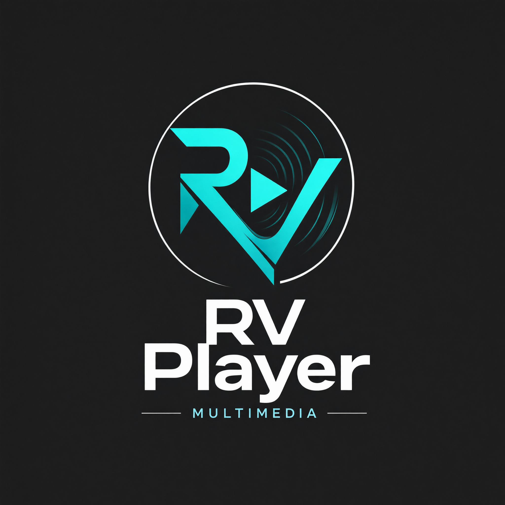

# 🎬 RV Player

Reproductor multimedia para Android (Kotlin + Jetpack Compose) con estética oscura
Material 3, motor **VLC/LibVLC**, catálogo de YouTube, visor de imágenes y descargas
con **yt-dlp**.


<p align="center">
  
</p>

RV Player reúne en una sola app la biblioteca local (vídeo, música, carpetas, artistas
y álbumes), la galería de fotos, YouTube y un gestor de descargas, todo con
reproducción mediante LibVLC y una interfaz inspirada en SimpMusic, Gallery y OpenTune.

## Funcionalidades

### 🎬 Biblioteca unificada
Una sola pantalla al estilo de los reproductores modernos, con pestañas en forma de
píldora: **Videos · Canciones · Playlists · Carpetas · Artistas · Álbumes**.
- **Videos** con miniatura real extraída del propio archivo, duración y resolución.
- **Selección múltiple** (mantener pulsado) para eliminar varios vídeos o canciones.
- **Canciones** en lista plana con carátula.
- **Carpetas / Artistas / Álbumes** con tarjetas y vista previa de canciones.
- Mini reproductor flotante que puede ocultarse tocando el logo/título de cualquier sección.

### 🎬 Reproductor de vídeo
- **LibVLC** (MKV, MP4, AVI, WebM, TS, FLV…).
- Play/Pausa, ±10 s, anterior/siguiente y barra de progreso.
- **Botón para rotar** la pantalla.
- **Deslizar en la mitad izquierda** = brillo; **mitad derecha** = volumen,
  con indicador en pantalla.
- Al salir de la pantalla, el vídeo **se detiene**.

### 🎵 Reproductor de audio
- Play/Pausa, anterior/siguiente y **retroceder/adelantar 10 s**.
- Aleatorio, repetir y repetir una.
- **Letras** vía LRCLib.
- **Ecualizador** con preajustes aplicados a VLC.
- **Temporizador de sueño**.
- Notificación con controles y MediaSession (pantalla de bloqueo).

### 🖼️ Galería
- Estilo **Material 3** inspirado en la app Gallery: barra con logo, pestañas Fotos / Álbumes / Favoritos.
- **Fotos** en cuadrícula de 4 columnas; **Álbumes** en tarjetas de 2 columnas con portada y conteo.
- Visor con zoom, compartir, información y eliminar; al borrar pasa a la imagen siguiente.

### ▶️ YouTube (estilo OpenTune)
- Búsqueda con filtros **Todo / Canciones / Vídeos / Álbumes / Artistas / Playlists** y resultados por secciones.
- **Música** con categorías: Éxitos 2026, Pop, Rock, Electro, Trance y Clásicos.
- Interruptor **«Seguir con la siguiente»** para decidir si continúa la lista o solo suena la canción pulsada.
- **Playlists y álbumes** con ficha propia (portada, autor, canciones y Reproducir).
- **Artistas**: al pulsarlos se muestran sus canciones.
- Miniaturas directas de `i.ytimg.com`.
- Reproducción mediante **NewPipeExtractor / yt-dlp** (más fiable que las APIs públicas).
- Menú **⋮** en cada fila: reproducir, descargar audio MP3 y favorito.

### ⬇️ Descargas con yt-dlp
- Pega la URL → elige **Audio (MP3)** o **Vídeo (MP4)**.
- Compatible con YouTube, TikTok, Instagram, Facebook, X y cientos de sitios.
- Progreso, velocidad, cancelar, reintentar, abrir y compartir.
- Botón **Actualizar** para actualizar el binario de yt-dlp.
- Audio en `Descargas/RVPlayer/audio` y vídeo en `Descargas/RVPlayer/video`.

### ⚙️ Ajustes
- Ocultar archivos ocultos y notas de voz (WhatsApp/Telegram).
- Notificaciones, batería y acceso a archivos.
- Actualizar/borrar biblioteca.

## Arquitectura

```
app/src/main/java/com/rvplayer/
├── core/
│   ├── playback/     PlaybackManager, VlcEngine, Playable
│   ├── download/     YtDlpEngine (yt-dlp + Python + FFmpeg)
│   └── util/         FileProviderUtils
├── data/
│   ├── model/        Room: MediaItem (path único), Download, Playlist…
│   ├── database/     AppDatabase v2, DAOs
│   └── repository/   Media, Playlist, Preferences, Lyrics, YouTube
└── ui/
    ├── navigation/   MainActivity + mini reproductor
    ├── library/      Biblioteca con pestañas
    ├── player/       Reproductor audio/vídeo, diálogos y servicio
    ├── gallery/      Fotos / Álbumes / Favoritos
    ├── youtube/      Catálogo y streaming
    ├── download/     Pantalla y servicio de descargas
    ├── settings/     Ajustes
    ├── components/   BottomBar, MiniPlayer…
    └── theme/        Paleta y tipografía
```

## Compilar

Requisitos: **JDK 17** y Android SDK 34 (platform + build-tools).

```bash
gradlew.bat assembleDebug     # Windows (desarrollo)
gradlew.bat assembleRelease   # Windows (producción, firmado)
./gradlew assembleRelease     # Linux / macOS
```

APK de desarrollo: `app/build/outputs/apk/debug/app-debug.apk`.
APK release firmado: `app/build/outputs/apk/release/app-release.apk`.

## Instalación

1. Descarga el APK release (`RVPlayer-*.apk`).
2. Activa «Instalar apps desconocidas» para tu explorador de archivos.
3. Instala el APK. Si tenías una versión **debug**, desinstálala primero:
   ```bash
   adb uninstall com.rvplayer
   ```
4. Al abrir, concede:
   - **Acceso a todos los archivos** (Android 11+) para descargar y borrar multimedia.
   - **Notificaciones** (Android 13+) para los controles del reproductor y las descargas.

> El release y el debug usan firmas distintas. Para actualizar entre versiones release
> conserva siempre el mismo keystore (`rvplayer-release.jks`).


> `minSdk 24` (requerido por yt-dlp). Solo se empaquetan ABIs **arm64-v8a** y
> **armeabi-v7a** para reducir el tamaño. El APK ronda los 160 MB porque incluye
> LibVLC + Python + FFmpeg.

> `local.properties` contiene la ruta del SDK de este equipo; bórralo al abrir el
> proyecto en otro equipo o en Android Studio.

## Créditos

- [VLC for Android](https://github.com/videolan/vlc) — motor de reproducción.
- [yt-dlp](https://github.com/yt-dlp/yt-dlp) — extracción y descargas.
- [NewPipeExtractor](https://github.com/TeamNewPipe/NewPipeExtractor) — extracción de YouTube (GPLv3).
- [YoutubeDL-Boom](https://github.com/farimarwat/YoutubeDl-Boom) — empaquetado de yt-dlp para Android.
- [SimpMusic](https://github.com/maxrave-dev/SimpMusic) — inspiración de la interfaz.
- [OpenTune](https://github.com/therajatshahare/OpenTune-Music) — inspiración del módulo de YouTube.
- [Gallery](https://github.com/brandonhxrr/Gallery) y [SealPlus](https://github.com/MaheshTechnicals/SealPlus) — inspiración de galería y descargas.
- [LRCLib](https://lrclib.net) — letras.
- Instancias públicas de [Piped](https://github.com/TeamPiped/Piped) — catálogo de YouTube.

## Aviso legal

Descarga únicamente contenido sobre el que tengas derechos o permiso.
